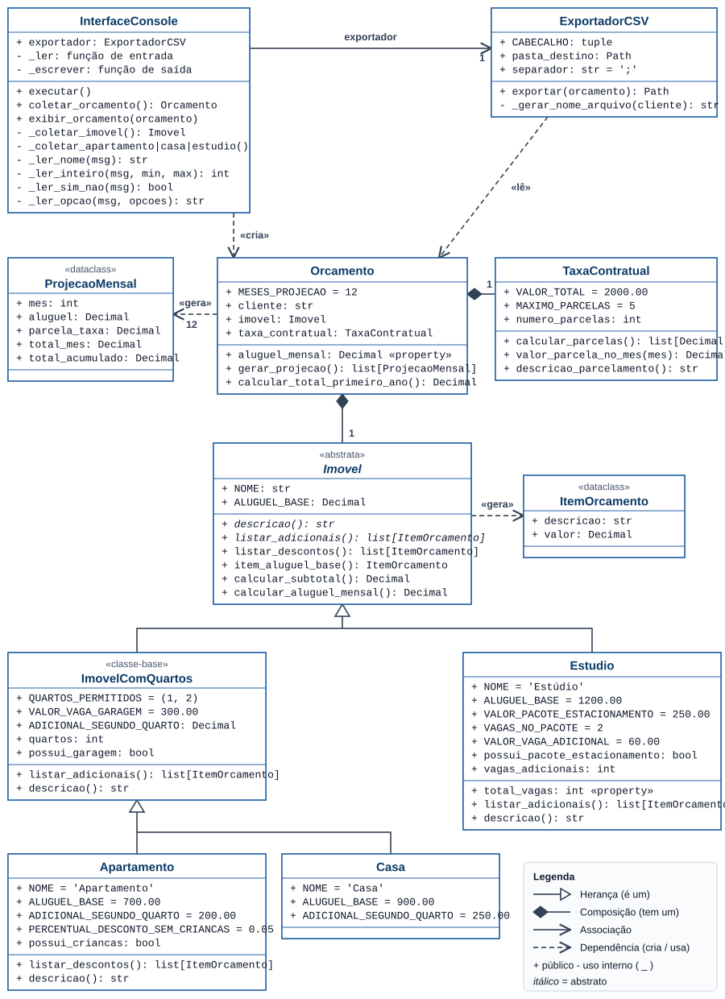
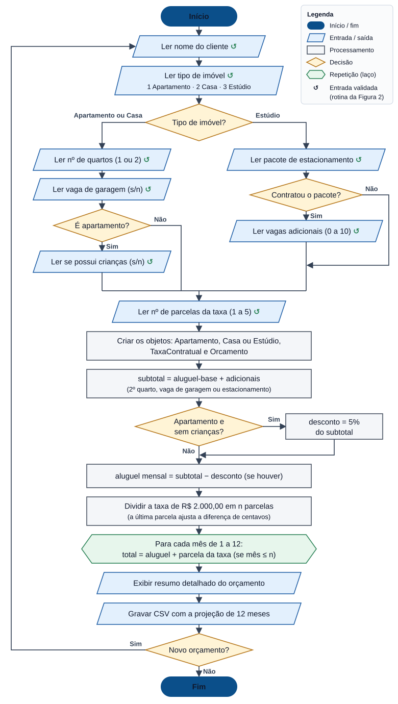
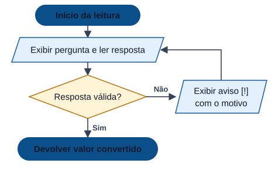

# RentSmart — Orçamento de Locação com Python e POO

Aplicação de console em Python que automatiza os orçamentos de locação da **R.M Imóveis**.
O sistema recebe as características da locação, valida as respostas, aplica as regras comerciais
da imobiliária, mostra como o valor mensal foi formado, apresenta a taxa contratual separada do
aluguel e gera um arquivo **CSV com a projeção dos 12 primeiros meses**.

Trabalho da disciplina *Algorithmic Thinking & Introduction to Object-Oriented Programming*
Autoria: **Livia Nunez**.

---

## Funcionalidades

- Orçamento para **apartamento**, **casa** ou **estúdio**, com adicionais e descontos aplicados automaticamente.
- **Validação de todas as entradas:** respostas inválidas mostram um aviso e a pergunta é repetida.
- **Resumo detalhado:** aluguel-base, cada adicional, subtotal, desconto e aluguel final.
- **Taxa contratual separada do aluguel**, com a condição de parcelamento escolhida (1 a 5 vezes).
- **Projeção de 12 meses** na tela e em arquivo `.csv` (pronto para abrir no Excel).
- Vários orçamentos na mesma execução.
- Valores monetários com `Decimal`, sem erros de arredondamento de `float`.
- **30 testes automatizados** cobrindo todas as regras de negócio.

## Regras de negócio

| Item | Apartamento | Casa | Estúdio |
|---|---|---|---|
| Aluguel-base | R$ 700,00 | R$ 900,00 | R$ 1.200,00 |
| 2 quartos | + R$ 200,00 | + R$ 250,00 | — |
| Vaga de garagem | + R$ 300,00 | + R$ 300,00 | — |
| Estacionamento | — | — | Pacote com 2 vagas: + R$ 250,00<br>Vaga adicional: + R$ 60,00 cada |
| Desconto | 5% se o cliente **não** tiver crianças (aplicado após os adicionais) | — | — |

**Taxa contratual:** R$ 2.000,00, cobrada à parte do aluguel, paga em 1 a 5 parcelas mensais.

## Como executar

**Requisito:** Python 3.9 ou superior. O projeto usa apenas a biblioteca padrão, então não é preciso instalar nada com `pip`.

1. Baixe o projeto (botão **Code → Download ZIP** no GitHub) ou clone o repositório:
   ```bash
   git clone https://github.com/livi4i/RentSmart.git
   cd RentSmart
   ```
2. Execute o programa na pasta do projeto:
   ```bash
   python main.py
   ```
   No Windows, se `python` não for reconhecido, use `py main.py`.
3. Responda às perguntas. Ao final, o CSV é salvo na pasta `saida/`.

## Exemplo de execução

Cliente que escolheu **apartamento com 2 quartos, vaga de garagem, sem crianças** e taxa em **3 parcelas**:

```text
==============================================================
                     ORÇAMENTO DE LOCAÇÃO
==============================================================
Cliente: Maria Souza
Imóvel : Apartamento - 2 quartos, com vaga de garagem, sem crianças

1. ALUGUEL MENSAL
  Aluguel-base (apartamento)                         R$ 700,00
  Adicional por 2 quartos                          + R$ 200,00
  Vaga de garagem                                  + R$ 300,00
  ------------------------------------------------------------
  Subtotal                                         R$ 1.200,00
  Desconto de 5% (cliente sem crianças)             - R$ 60,00
  ------------------------------------------------------------
  ALUGUEL MENSAL                                   R$ 1.140,00

2. TAXA CONTRATUAL (NÃO FAZ PARTE DO ALUGUEL)
  Valor total da taxa                              R$ 2.000,00
  Condição de pagamento                        Parcelada em 3x
    Parcela 1/3 (mês 1)                              R$ 666,67
    Parcela 2/3 (mês 2)                              R$ 666,67
    Parcela 3/3 (mês 3)                              R$ 666,66

3. PROJEÇÃO DOS 12 PRIMEIROS MESES
   Mês           Aluguel    Taxa contratual       Total do mês
     1       R$ 1.140,00          R$ 666,67        R$ 1.806,67
     2       R$ 1.140,00          R$ 666,67        R$ 1.806,67
     3       R$ 1.140,00          R$ 666,66        R$ 1.806,66
     4       R$ 1.140,00            R$ 0,00        R$ 1.140,00
   ...
    12       R$ 1.140,00            R$ 0,00        R$ 1.140,00
  ------------------------------------------------------------
  TOTAL PREVISTO NO 1º ANO                        R$ 15.680,00
==============================================================

Projeção de 12 meses salva em: saida\projecao_maria-souza_20261123_152754.csv
```

## Arquivo csv

O arquivo usa o padrão brasileiro (separador `;` e vírgula decimal) e codificação UTF-8 com BOM,
então abre direto no Excel com os acentos corretos. Exemplo completo em
[`docs/exemplo_projecao.csv`](docs/exemplo_projecao.csv):

| Mês | Aluguel (R$) | Parcela da taxa contratual (R$) | Total do mês (R$) | Total acumulado (R$) |
|---:|---:|---:|---:|---:|
| 1 | 1140,00 | 666,67 | 1806,67 | 1806,67 |
| 2 | 1140,00 | 666,67 | 1806,67 | 3613,34 |
| 3 | 1140,00 | 666,66 | 1806,66 | 5420,00 |
| 4 | 1140,00 | 0,00 | 1140,00 | 6560,00 |
| … | … | … | … | … |
| 12 | 1140,00 | 0,00 | 1140,00 | 15680,00 |

## Estrutura do projeto

```text
RentSmart/
├── main.py                  # ponto de entrada: python main.py
├── rentsmart/
│   ├── imoveis.py           # Imovel (abstrata), ImovelComQuartos, Apartamento, Casa, Estudio, ItemOrcamento
│   ├── contrato.py          # TaxaContratual (valor e parcelamento)
│   ├── orcamento.py         # Orcamento e ProjecaoMensal (projeção de 12 meses)
│   ├── exportador.py        # ExportadorCSV
│   ├── interface.py         # InterfaceConsole (perguntas, validação e exibição)
│   └── dinheiro.py          # arredondamento e formatação de valores em R$
├── tests/
│   └── test_rentsmart.py    # testes automatizados (unittest)
├── docs/
│   ├── fluxograma.svg
│   ├── validacao.svg
│   ├── diagrama_classes.svg
│   └── exemplo_projecao.csv
└── saida/                   # criada ao executar; recebe os CSVs gerados
```

## Arquitetura orientada a objetos

Cada classe tem uma única responsabilidade:

| Classe | Responsabilidade |
|---|---|
| `Imovel` (abstrata) | Define o algoritmo comum: aluguel = base + adicionais − descontos. |
| `ImovelComQuartos` | Regras compartilhadas por apartamento e casa (quartos e garagem). |
| `Apartamento`, `Casa`, `Estudio` | Valores e regras específicas de cada tipo de imóvel. |
| `ItemOrcamento` | Uma linha da composição do aluguel (descrição + valor). |
| `TaxaContratual` | Valor da taxa e cálculo das parcelas. |
| `Orcamento` | Reúne cliente, imóvel e taxa; gera a projeção de 12 meses. |
| `ProjecaoMensal` | Valores de um mês da projeção. |
| `ExportadorCSV` | Grava a projeção em arquivo `.csv`. |
| `InterfaceConsole` | Conversa com o usuário: lê, valida e exibe. Não contém regras de preço. |



Conceitos de POO aplicados:

- **Abstração:** `Imovel` é abstrata (`ABC`). Não existe "imóvel genérico", só tipos concretos.
- **Herança:** `Apartamento` e `Casa` herdam de `ImovelComQuartos`, e as regras de quartos e garagem são escritas uma vez só.
- **Polimorfismo:** o `Orcamento` chama `calcular_aluguel_mensal()` sem saber o tipo do imóvel; cada classe responde com suas próprias regras.
- **Encapsulamento:** cada regra (e cada preço) fica dentro da classe a que pertence, e os construtores rejeitam estados inválidos.
- **Composição:** um `Orcamento` *tem um* `Imovel` e *tem uma* `TaxaContratual`.

## Fluxograma



Todas as entradas marcadas com ↺ usam a mesma rotina de validação: a pergunta se repete até a resposta ser válida.



## Testes automatizados

Na pasta do projeto:

```bash
python -m unittest discover -v
```

Os 30 testes verificam todos os valores do enunciado: os adicionais de cada imóvel, o desconto
aplicado depois dos adicionais, a regra de estacionamento do estúdio, as parcelas da taxa (sempre
somando R$ 2.000,00), a projeção de 12 meses, o conteúdo do CSV e um atendimento completo com
respostas inválidas.

## Premissas adotadas

O enunciado deixa alguns pontos em aberto. As decisões tomadas foram:

1. **Desconto do apartamento:** os 5% incidem sobre o aluguel já com **todos** os adicionais (2º quarto e garagem), como diz a regra "após a aplicação dos adicionais".
2. **Estacionamento do estúdio** é opcional. Vagas adicionais (R$ 60,00 cada) só podem ser contratadas junto com o pacote inicial de 2 vagas. Por segurança, a interface aceita no máximo 10 vagas adicionais por orçamento.
3. **Casas e apartamentos** podem ter 1 ou 2 quartos e no máximo 1 vaga de garagem.
4. **Parcelas da taxa** são cobradas nos primeiros meses do contrato (mês 1 até o mês *n*). Quando a divisão não é exata (3x), a última parcela absorve a diferença de centavos: R$ 666,67 + R$ 666,67 + R$ 666,66 = R$ 2.000,00.
5. A projeção considera que o aluguel não sofre reajuste durante o primeiro ano.

